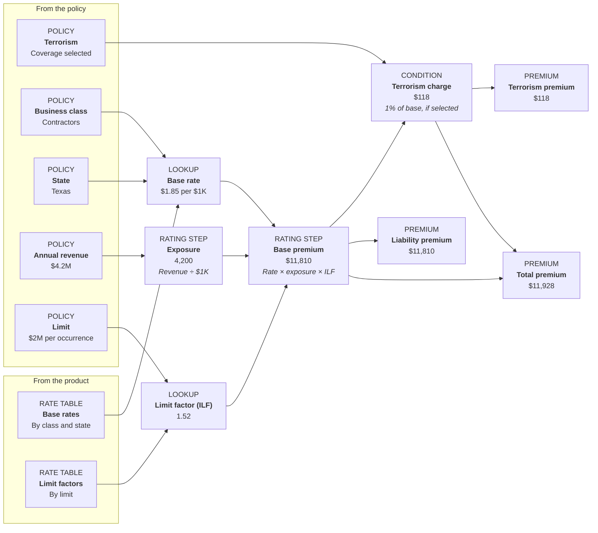

# Compute graphs

> Source: https://docs.federato.dev/product-studio/authoring/compute-graphs/ (transcribed from screenshots, 2026-10-14)

A **compute graph** is a product's rating logic represented **natively in Product Studio**. It captures every rule that turns a policy's details and the product's rate tables into a premium: which rates to look up, which factors apply, which coverages add a charge, and how it all adds up.

Here's an illustration of a simplified liability product, rated for one example policy:

Legend: Policy information · Rate tables · Lookups · Rating steps · Coverage conditions · Premium. (On the live page, hovering a step shows what feeds it and what it feeds.)

Every graph is built from the same core pieces:

- **Policy information** makes up the graph's **inputs**: what the submission or the underwriter supplies, such as the insured's class of business, state, revenue, limits, and coverage selections.
- **Rate tables** are the product's own data, such as base rates and increased limit factors. One table can serve many products.
- **Lookups** find the right entry in a rate table for this policy, such as the base rate for a Texas contractor.
- **Rating steps** do the arithmetic: exposure from revenue, then base premium from rate, exposure, and factors.
- **Coverage conditions** apply only when they're relevant, such as a terrorism charge when the insured selects terrorism coverage.
- **Premium** amounts make up the graph's **outputs**: the totals and breakdowns that appear on the quote and the policy.

## Why choose the compute graph?

- **It's faster.** Instead of running the workbook itself, the rating is calculated in-memory. Expect a ~100x speed boost.
- **Every premium can be explained.** Each step has a name and a value, so you can trace a premium back to the rates and factors behind it. When a step can't calculate, Product Studio points to where the problem started.
- **It gets Excel's answer.** The actuary's workbook is the authority on what a product charges. A graph reproduces Excel's results exactly, including edge cases the older spreadsheet engine calculated differently.

## Upload a compute graph

> 💡 Today, Product Studio only supports creating a compute graph by uploading an Excel workbook. In the future, we may support creating graph components (rate tables, lookup factors, etc) directly.

Uploading a compute graph is just as easy as uploading an Excel rater. Before you start, you need:

- A **draft** Product Version. A published version's workbook can't change.
- A blank workbook and a sample workbook (same as the Excel upload path).

Then:

1. On the draft version's rater step, choose **Excel Spreadsheet**, name the rater, and add the **Blank Workbook** and **Sample Workbook**.
2. Under **Engine**, choose **Compute graph**.
3. Upload. Product Studio skips the configure-sheets step for a compute graph.
4. Wait for the status badge. It reads `Extracting…` with the current stage while Product Studio builds the graph.
5. When it reads `Accepted · L2 <sha>`, the graph is ready. Map fields from the typed schema as you would for any rater.
6. Publish the version. Publishing rates the sample policy on the graph once more as a final check.

## Fix a rejected upload

If the badge reads `Rejected · <n> findings`:

1. Select **View findings**. Each finding names a sheet, cell, formula, and reason, such as a function the graph doesn't support or a sample result that doesn't match Excel.
2. Fix the flagged cell in the workbook. Only error findings block acceptance. Info findings describe something Product Studio handled, such as an intentional circular reference.
3. On the rater's Overview, select **Replace** and upload the corrected blank and sample workbooks.

Replacing is also how you retry an upload that failed for another reason. Uploading the same files again is fine.

> ⚠️ You may not be able to fix all issues yourself. For example, if the findings show an *unsupported function*, we'll need to add support for that function before you can re-upload. Post in the `#product-studio` channel for support.

## Change how an existing product rates

Some products still rate the older way, where Product Studio runs the workbook itself in a spreadsheet engine. Each workbook's engine is chosen when it's uploaded, and changing it, like any other rating change, happens through a workbook replacement:

- **On a draft,** select **Replace** on the rater's Overview and upload the revised workbook. You can choose the other engine here.
- **On a published product,** create a new Product Version, replace its workbook, wait for `Accepted`, and publish. Policies on earlier versions keep rating the way they always have, and a published version's graph never changes. To roll back, keep using the earlier version.
